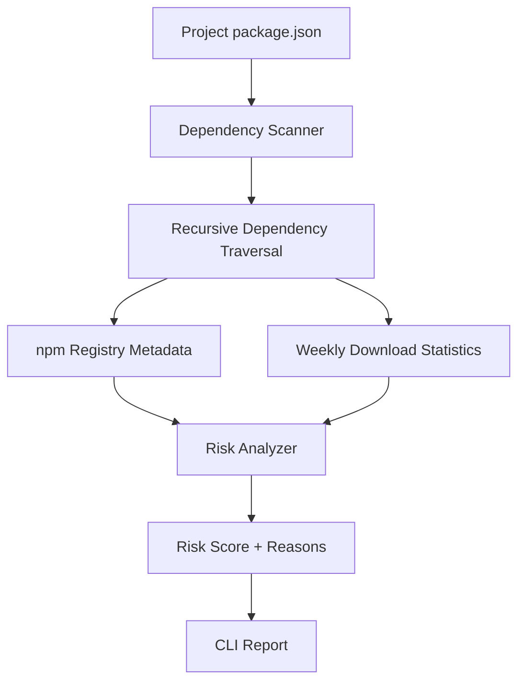

# PackageGuard

**A CLI tool for identifying potentially risky npm dependencies through transparent, metadata-based heuristics.**

PackageGuard scans a Node.js project's dependencies, checks npm registry metadata, and assigns risk scores with explanations for each finding.

It started from a practical question: *How can developers identify suspicious or potentially hallucinated package names before trusting them in a project?*

PackageGuard's current implementation focuses on package existence and metadata-based risk signals. It is a first step toward that goal, not a complete malware detector.

[](https://www.npmjs.com/package/packageguard)
[](https://www.npmjs.com/package/packageguard)
## Features

- **Dependency scanning:** Reads `dependencies` and `devDependencies` from a project's `package.json`.
- **Recursive traversal:** Explores locally installed dependency trees up to a maximum depth.
- **Registry checks:** Retrieves package metadata from the npm registry.
- **Download activity:** Uses npm's weekly download statistics as one risk signal.
- **Explainable scoring:** Produces a risk score, severity level, and reasons for each finding.
- **CLI summary:** Displays package-level findings and a count by severity.

## Architecture



### Design decisions

**1. Start with transparent heuristics**

PackageGuard uses explicit scoring rules instead of an opaque prediction. Each finding can include reasons that explain its score.

**2. Separate responsibilities**

The scanner discovers dependencies, registry modules retrieve package information, and the risk analyzer evaluates signals. This separation makes the code easier to test, understand, and extend.

**3. Include transitive dependencies**

Direct dependencies are only part of a project's dependency surface. PackageGuard also explores dependencies found in the local `node_modules` tree, with a depth limit to constrain traversal.

**4. Treat risk scores as signals, not verdicts**

A new package or one with low download activity is not automatically malicious. Scores help prioritize manual review rather than replace it.

## Risk scoring

The current scoring rules are:

| Signal | Points |
|---|---:|
| Package does not exist on npm | 100 |
| Package is less than 7 days old | +30 |
| Fewer than 100 weekly downloads | +20 |
| Repository metadata is missing | +15 |
| Install-time lifecycle script is present | +20 |

Scores are capped at 100.

| Score | Severity |
|---|---|
| 0–29 | LOW |
| 30–59 | MEDIUM |
| 60–79 | HIGH |
| 80–100 | CRITICAL |

The scanner prints the reasons contributing to a package's score.

> These are heuristic signals, not proof of malicious behavior. PackageGuard does not currently perform full malware analysis or establish whether a package name was hallucinated by an AI model.

## Installation

### Prerequisites

- Node.js and npm installed.
- Network access to query npm registry metadata and download statistics.

### Install from npm

Install PackageGuard globally:

```bash
npm install -g packageguard
```

Verify the installation:

```bash
packageguard --version
```

### Run without a global installation

You can use `npx` instead:

```bash
npx packageguard scan
```

## Usage

Scan the current project's dependencies:

```bash
packageguard scan
```

Scan a project at a specific path:

```bash
packageguard scan ./path-to-project
```

View available commands:

```bash
packageguard --help
```

PackageGuard needs network access to retrieve npm metadata and download statistics.

## Current limitations

- Risk scores are heuristic indicators, not definitive security verdicts.
- Dependency traversal relies on the locally installed dependency tree and has a maximum depth.
- Registry requests require network access.
- Download statistics and package metadata may be incomplete or unavailable.
- Package-name similarity checks for typosquatting are not currently implemented.
- Packages are not executed in a sandbox for behavioral analysis.

## Development

Want to explore the code or contribute?

Clone the repository:

```bash
git clone https://github.com/ishika-thakur7802/packageguard.git
cd packageguard
npm install
```

Build the project:

```bash
npm run build
```

Run the tests:

```bash
npm test
```

## Contributing

Feedback, bug reports, and contributions are welcome.

PackageGuard is an evolving project exploring dependency discovery, npm registry integration, and explainable risk scoring.

## Read more here: 
[https://dev.to/ishikathakur7802/building-packageguard-dependency-traversal-external-apis-and-explainable-risk-scoring-in-2hmf
](url)
